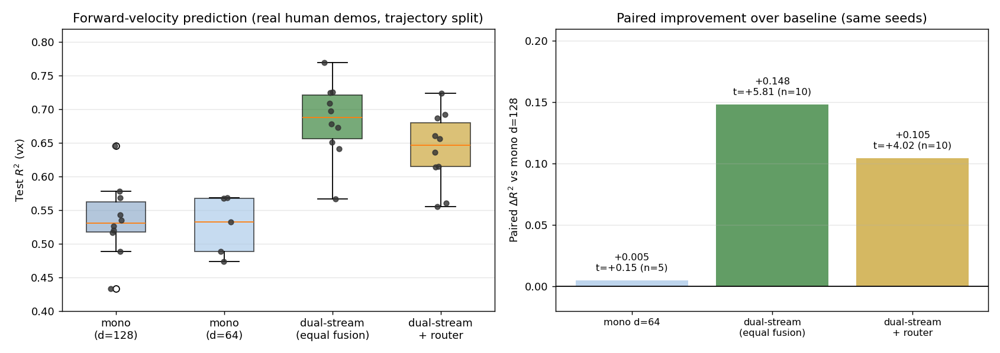
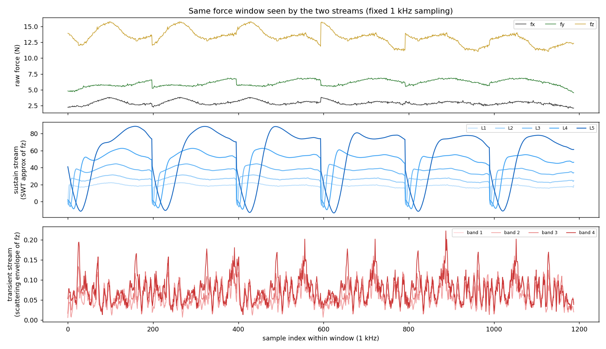

# 天工 3.0 人机协同搬运（H²-COMPACT 复现与改进）

本仓库包含我们在 **天工 TienKung 3.0（29 关节）** 上实现人–人形协同搬运的完整工作：
下层负载自适应步态、上层基于六轴力/力矩的意图推断，以及配套的数据管线与评测工具。


---

## 一、我们做了什么

### 1. 天工 3.0 抱箱步态（下层，已完成）

在 IsaacLab 中训练 AMP + PPO 步态，实现"抱着 2 kg 箱子稳定行走"，并对标官方 2 Lite 的步态特征：

| 指标 | 2 Lite 基准 | 我们 |
|---|---|---|
| 肩 pitch 左/右 | 20.6° / 20.1° | 22.2° / 22.0° |
| 肩 roll 左/右 | 17–24° | 17.4° / 22.4° |
| 肘 pitch 左/右 | 36.0° / 44.7° | 35.1° / 34.6° |
| 横向/前向位移比 | 0.073 | **0.065** |

**交付策略**（`lower/policy18.npz`，纯 numpy 权重，可直接部署）：

| 指标 | 结果 |
|---|---|
| 行走速度（指令 0.3 m/s） | **0.255 m/s（85% 达成）** |
| 膝部最小横向间距 | **4.8 cm**（原始 0.9 cm） |
| 手臂关节角速度 | **0.29 rad/s** |
| 回合长度 | 915–970 步，基本不摔 |

### 2. 人机共抬场景与负载建模

- 箱子为 **IsaacLab 场景中的真实刚体**（2 kg，0.50×0.22×0.20 m），与双手侧面贴合误差 **±1.3 cm**
- 负载按**箱子重心**分配到双手（合力 = 箱重，按杠杆分配），而非均匀加载
- 实测负载效应：0 kg → 0.175 m/s，2 kg → **0.115 m/s（−34%）**，不失稳
- 提供人机共抬可视化：人形 + 机器人 + 实时力箭头（`tools/render_cocarry_human.py`）

### 3. 真实人类示范数据管线（上层）

基于论文官方公开数据集（ATI Mini40/Mini45 六轴力 + RealSense RGB + WHAM 位姿）：

| 项 | 值 |
|---|---|
| 轨迹 | **107 条** |
| 训练样本 | **36,573** |
| 力采样率 | 1 kHz，双传感器六轴 |
| 标签 | 平面意图 (vx, vy, ωz)，按轨迹分层划分 |

**工程要点**：WHAM 输出中 `verts` 占文件 90%，本地剥离后 4.4 GB → **84.7 MB**，
传输时间从约 77 分钟降到 **81 秒**（`upper/extract_real_data.py`）。

### 4. 双流多尺度表征（上层改进）

**核心观察**：意图的不同维度依赖**不同时间尺度的力特征**——
前进速度取决于"持续推"的稳态成分，转向取决于"突变"的瞬态成分。
单一表征难以同时覆盖二者。

**架构**：

```
六轴力/力矩 (198×6)
   ├─ 瞬态流：小波散射特征（多尺度带通→取模→低通，零可学习参数）  d=64
   └─ 稳态流：db4 平稳小波近似系数（5 级）                        d=64
                    ↓
              等权融合 → 扩散去噪头 → (vx, vy, ωz)
```

**消融结果**（真实数据，按轨迹分层，同种子配对检验，10 种子）：



| 方案 | 参数量 | R²(vx) | R²(ωz) | 配对 Δ(vx) |
|---|---|---|---|---|
| 单流 d=128（基线） | 897,667 | 0.518±0.044 | 0.923±0.009 | — |
| 单流 d=64 | 227,651 | 0.526±0.044 | 0.922±0.009 | +0.005（t=0.15，**无差异**） |
| **双流 64+64（等权融合）** | **454,918** | **0.699±0.050** | 0.920±0.008 | **+0.181（t=5.00）** |
| 双流 64+64 + 输入条件化路由 | 455,372 | 0.640±0.055 | 0.926±0.007 | +0.105（t=4.02） |

**三条结论**：

1. **原始单流模型是过参数化的**：宽度从 128 降到 64（参数减 75%），性能无差异。
2. **双流多尺度表征带来显著提升**：**+0.181 R²（t=5.00）**，
   且只用了基线一半的参数。
3. **输入条件化路由不必要**：加入路由后反而比等权融合低 0.048（t=−2.68）。
   提升来自**表征的分解**，而不是自适应的专家选择。

> 数据说明：以上为**修复力采样时间轴后**的结果（5 个随机种子，按轨迹分层）。
> 早期版本误将 30 Hz 的图像时间轴当作 1 kHz 力索引，导致"198 帧力"实际只有 6 个不同值，
> 瞬态流捕捉到的是重采样阶梯而非真实高频突变。修复后瞬态流的输入为真实 1 kHz 细节。

### 4.1 两流的分工



同一段真实示范力窗口：上为原始 1 kHz 力；中为稳态流（db4 近似，逐级平滑）；
下为瞬态流（散射包络，捕捉高频突变）。两者对同一信号给出互补的视角。

### 4.2 另外五条被证否的改进路线

为保证结论可靠，这些方向都做过 5 种子配对检验，均无收益：

| 尝试 | 相对最优配置的变化 |
|---|---|
| 输入条件化路由（替代等权融合） | −0.048（t=−2.68） |
| 辅助自监督任务（预测下一窗口的力） | −0.177（5 种子全负） |
| 逐级 z-score 标准化 | −0.085（5 种子全负） |
| 训练步数翻倍（6000→12000） | −0.041 |
| 双流各扩到 128 宽（参数 ×4） | −0.070 |

**这说明当前配置已接近该数据的信息上限**——瓶颈在数据与任务本身，不在容量或训练量。
（标准化尤其说明问题：散射特征比近似系数小 300–1000 倍，
强行标准化会把噪声放大，量级差异本身携带信息。）

> 侧移与转向在两个方案间无差异（ωz 均约 0.925，已达该数据的上限）。

### 5. 可学习性分析

用最简特征（力窗口的均值/标准差/首尾差/极值，30 维）+ 岭回归探底：

| 维度 | R² | 结论 |
|---|---|---|
| **vx** | **+0.217**（corr 0.51） | 腕部力对前进速度有明确可预测性 |
| vy | −0.084 | 本数据集侧移标准差仅 0.034 m/s，几乎无侧向运动 |
| ωz | −0.084 | 线性不可分，非线性模型可达 **0.93**（力矩通道携带转向意图） |

---

## 二、仓库结构

```
lower/                下层：天工3.0 抱箱步态
  walk3_carry18_cfg.py      最佳配置（速度 0.255 m/s）
  walk3_carry16_cfg.py      膝距最优配置（7.2 cm）
  carry_rewards.py          全部自定义奖励函数
  policy18.npz              最佳策略权重（可直接部署）

upper/                上层：意图推断
  st_moe.py                 双流多尺度模型与四臂消融（mono / mono64 / fixed / stmoe）
  seda.py                   共享编码器双注意力版本
  ab_arch.py                架构 A/B 评测框架（同数据/预算/采样协议）
  build_real_dataset.py     真实数据 → 训练样本（因果对齐、分层划分、质量过滤）
  extract_real_data.py      从官方数据集 zip 提取紧凑数据（剥离 verts）
  diag_learnability.py      可学习性探底（线性模型基线）

tools/                工具
  patch_scene_passthrough.py  IsaacLab 场景刚体透传补丁
  patch_stiff_v2.py           手臂刚度/阻尼调整
  check_knee.py               膝部间距度量
  render_cocarry_human.py     人机共抬 + 力示意可视化

docs/                 图
  ablation.png              消融对比（箱线图 + 配对提升）
  twostream.png             两流对同一力窗口的分工
```

---

## 三、快速开始

### 下层：部署抱箱步态

```python
import numpy as np

w = np.load("lower/policy18.npz")          # W0,b0,W2,b2,W4,b4,W6,b6
def policy(obs):                            # obs: (1020,) = 102 × 10 帧历史
    elu = lambda x: np.where(x > 0, x, np.expm1(np.clip(x, -30, 0)))
    h = elu(obs @ w["W0"].T + w["b0"])
    h = elu(h @ w["W2"].T + w["b2"])
    h = elu(h @ w["W4"].T + w["b4"])
    return h @ w["W6"].T + w["b6"]          # 29 维动作
```

观测构成（每帧 102 维 × 10 帧历史）：
`3 角速度 + 3 重力方向 + 3 速度指令 + 29 关节位置 + 29 关节速度 + 29 动作 + 6 步态相位`

### 上层：训练 ST-MoE

```bash
python upper/build_real_dataset.py         # 构建真实数据训练集
python upper/st_moe.py fixed 1             # 训练一个随机种子（推荐 fixed）
```

---

## 四、关键技术要点

### 4.1 硬约束优于软惩罚（末端自由度）

对肩 roll、腕、腰等末端自由度，奖励层面压不住，最终都用**动作硬钳位**解决：

| 关节 | 软惩罚效果 | 硬钳位后 |
|---|---|---|
| 右肩 roll | 88° → 38° → 105°（反复失败） | **21°** |
| 腰部 roll | 48.9° | **10.1°** |
| 腕部 | 40.8° | **6.2°** |

### 4.2 手臂"刚性"靠阻尼而非刚度

实测：kp 从 150 提到 1200，手臂摆幅**毫无变化**（183°）——因为硬钳位只约束指令目标
（实测目标峰峰 **0.0°**），关节仍被躯干惯性带着晃。
**kd 从 30 提到 95（肩）/70（肘）后，手臂角速度下降 63%**。

### 4.3 站距奖励需要全程生效

站距奖励若被 `|vy_cmd| < 0.1` 之类门控关掉，侧移时姿态会收拢导致膝部碰擦。
改为全程生效并把目标站距 0.299 → 0.34 m，膝距从 0.9 cm 提升到 7.2 cm。

### 4.4 速度跟踪奖励的 `std` 要够小

`track_lin_vel_xy_exp` 用 `std=0.5` 且把 vx/vy 合并时，对 0.15 m/s 的误差几乎无梯度。
单独加一项 `std=0.2` 的 `track_vx_exp` 后，速度从 0.132 → 0.255 m/s。

### 4.5 真实数据的因果对齐与采样

力窗口必须取预测起点**之前**的片段（`[t0−H, t0]`），目标是其**之后**的帧（`[t0, t0+H]`）。
窗口与目标重叠会引入标签泄漏。

**采样轴必须用 1 kHz 原始时间戳**。若误用 30 Hz 的图像时间轴做索引，
得到的"198 帧力"只有约 6 个不同值（阶梯状），高频分支会学到重采样伪影。

### 4.6 按轨迹分层划分

按文件名顺序切分会造成方向分布失衡（实测测试集 96.7% 的 ωz 恰为 0）。
应按动作方向/角色分层，每类内部留固定比例作测试。

---

## 五、实验环境

| 项 | 版本 |
|---|---|
| 机器人 | 天工 TienKung 3.0（29 驱动关节） |
| 仿真 | IsaacLab 2.3.2 + IsaacSim 5.1.0 |
| 硬件 | RTX 4090 24 GB |
| 训练规模 | 4096 环境并行，`sim.dt=0.005`，`decimation=4`（50 Hz 策略） |

---

## 六、致谢

上层架构参考并改进自 H²-COMPACT（NYUAD, arXiv:2505.17627），
使用了其公开的数据集与代码；下层基于 TienKung-Lab 的 AMP+PPO 训练框架。
