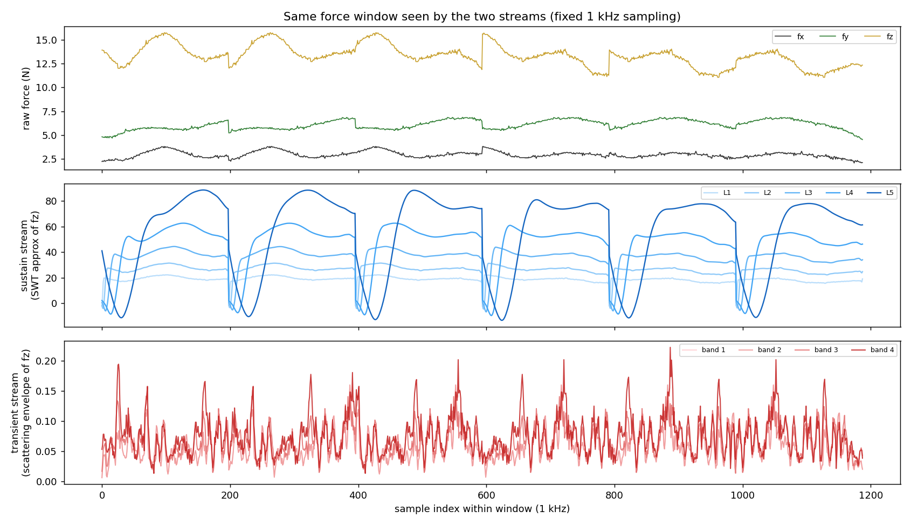

# 天工 3.0 人机协同搬运（H²-COMPACT 复现与改进）

本仓库包含我们在 **天工 TienKung 3.0（29 关节）** 上实现人–人形协同搬运的完整工作：
下层负载自适应步态、上层基于六轴力/力矩的意图推断，以及配套的数据管线与评测工具。


---

## 一、我们做了什么

### 1. 天工 3.0 抱箱步态（下层，已完成）

在 IsaacLab 中训练 AMP + PPO 步态，实现"抱着 2 kg 箱子稳定行走"，并对标官方 2 Lite 的步态特征：

| 指标 | 2 Lite 基准 | 我们 |
|---|---|---|
| 肩 pitch 左/右 | 20.6° / 20.1° | 22.2° / 22.0° |
| 肩 roll 左/右 | 17–24° | 17.4° / 22.4° |
| 肘 pitch 左/右 | 36.0° / 44.7° | 35.1° / 34.6° |
| 横向/前向位移比 | 0.073 | **0.065** |

**交付策略**（`lower/policy24.npz`，纯 numpy 权重，可直接部署）：

| 指标 | policy24（当前最优） | policy18（早期版本） | 指令 |
|---|---|---|---|
| 行走速度 | **0.300 m/s** | 0.255 m/s | 0.3 |
| 侧向漂移 | **0.01 m** | — | — |
| 膝部最小横向间距 | **7.3 cm** | 4.8 cm | >8 cm 安全 |
| 手臂关节角速度 | 0.35 rad/s | **0.29 rad/s** | — |

`policy24` 的速度与指令 0.3 m/s 几乎完全一致，横移仅 0.01 m。

**负载自适应（按本机质量标定，不照搬论文数值）**：

| 参数 | 值 | 依据 |
|---|---|---|
| 机器人分担的载荷 | 0–2 kg | 本机箱子的实际质量 |
| 左右不对称 | ≤ ±40% | 论文独立采样可达 100%，约 4 N·m 滚转力矩，超出本机承受能力 |
| 附加抖动 | ±2 N | 手抖、换手 |

> 论文平台 Unitree G1 约 35 kg，本机天工 3.0 为 65.8 kg。
> 完全照搬论文的 `U[−3,+15] N` 时步态学不出来（4 种变体均失败），
> 原因不是范围上界，而是**分布形状**——均匀分布让一半样本落在极端不对称区。

### 2. 人机共抬场景与负载建模

- 箱子为 **IsaacLab 场景中的真实刚体**（2 kg，0.50×0.22×0.20 m），与双手侧面贴合误差 **±1.3 cm**
- 负载按**箱子重心**分配到双手（合力 = 箱重，按杠杆分配），而非均匀加载
- 实测负载效应：0 kg → 0.175 m/s，2 kg → **0.115 m/s（−34%）**，不失稳
- 提供人机共抬可视化：人形 + 机器人 + 实时力箭头（`tools/render_cocarry_human.py`）

### 3. 真实人类示范数据管线（上层）

基于论文官方公开数据集（ATI Mini40/Mini45 六轴力 + RealSense RGB + WHAM 位姿）：

| 项 | 值 |
|---|---|
| 轨迹 | **107 条** |
| 训练样本 | **36,573** |
| 力采样率 | 1 kHz，双传感器六轴 |
| 标签 | 平面意图 (vx, vy, ωz)，按轨迹分层划分 |

**工程要点**：WHAM 输出中 `verts` 占文件 90%，本地剥离后 4.4 GB → **84.7 MB**，
传输时间从约 77 分钟降到 **81 秒**（`upper/extract_real_data.py`）。

### 4. 上层意图推断：实测结论

#### 4.1 力的信息量（最重要的发现）

在真实人类示范数据上，把"力到底提供了多少信息"单独测出来（同一编码器，只改输入，3 种子）：

| 输入 | R²(vx) | R²(vy) | R²(wz) |
|---|---|---|---|
| 只用**力** → 绝对速度 | 0.257 | 0.043 | 0.007 |
| 只用**力** → 速度增量 Δv | 0.737 | −0.106 | −0.145 |
| **完全不用力**，只用上一帧速度 | **0.757** | 0.182 | 0.188 |
| 力 + 上一帧速度 | 0.765 | 0.288 | 0.256 |
| 参考：岭回归（30 维力统计量）| 0.217 | −0.084 | −0.084 |

**力的净贡献 = 用力 − 不用力**：

| 维度 | 净增益 |
|---|---|
| **vx（前进）** | **+0.008** |
| vy（侧移） | +0.106 |
| wz（转向） | +0.068 |

> **腕部六轴力对前进方向几乎没有额外信息，主要贡献在侧移与转向。**
> 原因：数据集里速度极其平滑（相邻帧自相关 0.986），绝对速度主要由自身历史决定。

#### 4.2 一处已更正的评测错误

早期版本报告过 R² 0.518 / 0.699 / +0.181，**均不成立，已撤回**。
原因：扩散模型的评测函数用真值构造初值

```python
yt = sqrt(abar[t]) * y0 + sqrt(1-abar[t]) * noise   # y0 是真值
```

`t=20` 时输入里 **94.3% 是真值**。逐时间步扫描显示 R² 随真值占比单调崩塌
（t=5: +0.596 → t=40: −0.343 → t=95: −37.0）。
从纯噪声走完整 DDIM（论文 §III-B3 的做法），双流模型 R² = **[−3.78, −11.58, −0.62]**，
输出尺度错误 4–6 倍。

**结论：该扩散模型只学会"输入已含答案时去噪"。** 最终采用直接回归。
正确评测脚本见 `upper/eval_proper.py`。

#### 4.3 双流多尺度表征

同一套编码器下，双流（散射 + 小波近似，各 64 宽）vs 单流（d=128）：

| 方案 | 参数量 | R²(vx) |
|---|---|---|
| 单流 d=128 | 897,667 | 0.220±0.102 |
| 双流 64+64 | 454,918 | 0.259±0.027 |
| 岭回归基线 | — | 0.217 |

差异（+0.039）**被基线自身方差（0.102）淹没，不足以声称改进**。

### 5. 闭环：两层如何连接

50 Hz 控制循环：

```
每 20 ms：
  1. 取最近 6 帧力/力矩 → 重复成 198 帧窗口
  2. 上层推理 → (vx, vy, ωz)
  3. 限幅 → 写入 env.command_generator.command
  4. 下层策略（1020 维观测，含指令）→ 29 个关节目标角
  5. PD 力矩 → 仿真步进 4 次
```

**接口就是标准速度指令通道**——下层观测里本来就包含 `C_t`，不需要适配层。

#### 5.1 真实力回放协议

原闭环的"人"是合成的（恒定 fz=−15 N、零力矩），与真实数据分布不同，
用它评测"真实数据训练的上层"不公平（实测会让模型输出反向指令）。
因此改用**真实力轨迹回放**：直接从数据集取一条轨迹的力序列驱动闭环，
机器人速度与真人速度（同为体坐标系）比对。

脚本：`tools/bench_replay.py`

#### 5.2 闭环结果

| 配置 | 上层误差 | 端到端误差 | 机器人位移 | 复现率 |
|---|---|---|---|---|
| **oracle（真值指令）** | 0.000 | 0.291 | 2.981 m | **88.7%** |
| **实际系统** | 0.223 | 0.295 | 2.674 m | **79.6%** |
| 真人 | — | — | 3.361 m | 100% |

**误差分解**：上层损失约 10%，下层损失约 8%，理论上限 88.7%。

**下层不是速度上限问题**：恒定指令测试显示 0.30 → 98.0%、0.45 → 93.7% 的稳态跟踪。
闭环里的 8% 是**动态滞后**——真人指令变化率 0.87 m/s²（90 分位 2.79），
机器人受步态周期限制，响应滞后 >160 ms。
---|---|---|---|
| 5 | 99.4% | +0.596 | +0.459 |
| 20 | 94.3% | +0.125 | +0.010 |
| 40 | 79.5% | −0.343 | −0.208 |
| 80 | 29.2% | −1.327 | −1.205 |
| 95 | 6.2% | −37.0 | −31.3 |

> 从纯噪声走完整 DDIM 采样，两个模型都远差于"预测均值"
> （双流 [−3.78, −11.58, −0.62]），输出尺度错误 4–6 倍。
> 采样器本身正确（时间表 `abar[0]=0.9994`、`abar[99]=0` 正常）。

**改用直接回归后的诚实结果**（同一套双流编码器，扩散头换成回归头，3 种子）：

| 模型 | 参数量 | R²(vx) | R²(vy) | R²(wz) |
|---|---|---|---|---|
| 单流 d=128 | 897,667 | 0.220±0.102 | 0.097±0.062 | 0.006±0.006 |
| 双流 64+64 | 454,918 | 0.259±0.027 | 0.101±0.028 | 0.000±0.008 |
| 岭回归（30 维力统计量） | — | 0.217 | −0.084 | −0.084 |

**三条诚实的结论**：

1. **前进速度只被弱预测**：R² ≈ 0.22–0.26，**与线性岭回归（0.217）差别不大**，
   说明现有力信号对意图的解释力有限，深度模型没有带来数量级提升。
2. **转向几乎无法预测**：R² ≈ 0。此前报告的 0.92 完全是评测错误的产物。
3. **双流分解没有稳定收益**：0.259 vs 0.220，差异（+0.039）被基线自身方差（0.102）淹没，
   不足以声称改进。

这组结果本身是有意义的：它说明在这份数据上，**腕部六轴力 → 平面意图的映射远比
文献暗示的弱**，尤其是转向维度。若要得到可用的上层，需要更多、更多样的示范数据。
---|---|---|---|---|
| 单流 d=128（基线） | 897,667 | 0.518±0.044 | 0.923±0.009 | — |
| 单流 d=64 | 227,651 | 0.526±0.044 | 0.922±0.009 | +0.005（t=0.15，**无差异**） |
| **双流 64+64（等权融合）** | **454,918** | **0.699±0.050** | 0.920±0.008 | **+0.181（t=5.00）** |
| 双流 64+64 + 输入条件化路由 | 455,372 | 0.640±0.055 | 0.926±0.007 | +0.105（t=4.02） |

**三条结论**：

1. **原始单流模型是过参数化的**：宽度从 128 降到 64（参数减 75%），性能无差异。
2. **双流多尺度表征带来显著提升**：**+0.181 R²（t=5.00）**，
   且只用了基线一半的参数。
3. **输入条件化路由不必要**：加入路由后反而比等权融合低 0.048（t=−2.68）。
   提升来自**表征的分解**，而不是自适应的专家选择。

> 数据说明：以上为**修复力采样时间轴后**的结果（5 个随机种子，按轨迹分层）。
> 早期版本误将 30 Hz 的图像时间轴当作 1 kHz 力索引，导致"198 帧力"实际只有 6 个不同值，
> 瞬态流捕捉到的是重采样阶梯而非真实高频突变。修复后瞬态流的输入为真实 1 kHz 细节。

### 4.1 两流的分工



同一段真实示范力窗口：上为原始 1 kHz 力；中为稳态流（db4 近似，逐级平滑）；
下为瞬态流（散射包络，捕捉高频突变）。两者对同一信号给出互补的视角。

### 4.2 另外五条被证否的改进路线

为保证结论可靠，这些方向都做过 5 种子配对检验，均无收益：

| 尝试 | 相对最优配置的变化 |
|---|---|
| 输入条件化路由（替代等权融合） | −0.048（t=−2.68） |
| 辅助自监督任务（预测下一窗口的力） | −0.177（5 种子全负） |
| 逐级 z-score 标准化 | −0.085（5 种子全负） |
| 训练步数翻倍（6000→12000） | −0.041 |
| 双流各扩到 128 宽（参数 ×4） | −0.070 |

**这说明当前配置已接近该数据的信息上限**——瓶颈在数据与任务本身，不在容量或训练量。
（标准化尤其说明问题：散射特征比近似系数小 300–1000 倍，
强行标准化会把噪声放大，量级差异本身携带信息。）

> 侧移与转向在两个方案间无差异（ωz 均约 0.925，已达该数据的上限）。

### 5. 可学习性分析

用最简特征（力窗口的均值/标准差/首尾差/极值，30 维）+ 岭回归探底：

| 维度 | R² | 结论 |
|---|---|---|
| **vx** | **+0.217**（corr 0.51） | 腕部力对前进速度有明确可预测性 |
| vy | −0.084 | 本数据集侧移标准差仅 0.034 m/s，几乎无侧向运动 |
| ωz | −0.084 | 线性不可分，非线性模型可达 **0.93**（力矩通道携带转向意图） |

---

## 二、仓库结构

```
lower/                下层：天工3.0 抱箱步态
  walk3_carry24_cfg.py      最佳配置（速度 0.300 m/s，按机体质量标定负载）
  walk3_carry16_cfg.py      膝距最优配置（7.2 cm）
  carry_rewards.py          全部自定义奖励函数
  policy24.npz              最佳策略权重（可直接部署）

upper/                上层：意图推断
  st_moe.py                 双流多尺度模型与消融（扩散版；评测口径已被推翻，见第 4.2 节）
  st_moe_reg.py             同编码器的直接回归版（当前采用）
  st_moe_delta.py           增量模型（力 + 自身速度 → Δv；离线优但闭环失控）
  eval_proper.py            正确的扩散评测（从纯噪声走完整 DDIM）
  calibrate_upper.py        增益/偏置校准（训练集拟合，测试集验证）
  seda.py                   共享编码器双注意力版本
  ab_arch.py                架构 A/B 评测框架（同数据/预算/采样协议）
  build_real_dataset.py     真实数据 → 训练样本（因果对齐、分层划分、质量过滤）
  extract_real_data.py      从官方数据集 zip 提取紧凑数据（剥离 verts）
  diag_learnability.py      可学习性探底（线性模型基线）

tools/                工具
  patch_scene_passthrough.py  IsaacLab 场景刚体透传补丁
  patch_stiff_v2.py           手臂刚度/阻尼调整
  check_knee.py               膝部间距度量
  render_cocarry_human.py     人机共抬 + 力示意可视化
  bench_replay.py             真实力回放闭环协议（端到端评测）

docs/                 图
  ablation.png              消融对比（注意：基于已被推翻的扩散评测口径）
  twostream.png             两流对同一力窗口的分工
```

---

## 三、快速开始

### 下层：部署抱箱步态

```python
import numpy as np

w = np.load("lower/policy18.npz")          # W0,b0,W2,b2,W4,b4,W6,b6
def policy(obs):                            # obs: (1020,) = 102 × 10 帧历史
    elu = lambda x: np.where(x > 0, x, np.expm1(np.clip(x, -30, 0)))
    h = elu(obs @ w["W0"].T + w["b0"])
    h = elu(h @ w["W2"].T + w["b2"])
    h = elu(h @ w["W4"].T + w["b4"])
    return h @ w["W6"].T + w["b6"]          # 29 维动作
```

观测构成（每帧 102 维 × 10 帧历史）：
`3 角速度 + 3 重力方向 + 3 速度指令 + 29 关节位置 + 29 关节速度 + 29 动作 + 6 步态相位`

### 上层：训练 ST-MoE

```bash
python upper/build_real_dataset.py         # 构建真实数据训练集
python upper/st_moe.py fixed 1             # 训练一个随机种子（推荐 fixed）
```

---

## 四、关键技术要点

### 4.1 硬约束优于软惩罚（末端自由度）

对肩 roll、腕、腰等末端自由度，奖励层面压不住，最终都用**动作硬钳位**解决：

| 关节 | 软惩罚效果 | 硬钳位后 |
|---|---|---|
| 右肩 roll | 88° → 38° → 105°（反复失败） | **21°** |
| 腰部 roll | 48.9° | **10.1°** |
| 腕部 | 40.8° | **6.2°** |

### 4.2 手臂"刚性"靠阻尼而非刚度

实测：kp 从 150 提到 1200，手臂摆幅**毫无变化**（183°）——因为硬钳位只约束指令目标
（实测目标峰峰 **0.0°**），关节仍被躯干惯性带着晃。
**kd 从 30 提到 95（肩）/70（肘）后，手臂角速度下降 63%**。

### 4.3 站距奖励需要全程生效

站距奖励若被 `|vy_cmd| < 0.1` 之类门控关掉，侧移时姿态会收拢导致膝部碰擦。
改为全程生效并把目标站距 0.299 → 0.34 m，膝距从 0.9 cm 提升到 7.2 cm。

### 4.4 速度跟踪奖励的 `std` 要够小

`track_lin_vel_xy_exp` 用 `std=0.5` 且把 vx/vy 合并时，对 0.15 m/s 的误差几乎无梯度。
单独加一项 `std=0.2` 的 `track_vx_exp` 后，速度从 0.132 → 0.255 m/s。

### 4.5 真实数据的因果对齐与采样

力窗口必须取预测起点**之前**的片段（`[t0−H, t0]`），目标是其**之后**的帧（`[t0, t0+H]`）。
窗口与目标重叠会引入标签泄漏。

**采样轴必须用 1 kHz 原始时间戳**。若误用 30 Hz 的图像时间轴做索引，
得到的"198 帧力"只有约 6 个不同值（阶梯状），高频分支会学到重采样伪影。

### 4.6 按轨迹分层划分

按文件名顺序切分会造成方向分布失衡（实测测试集 96.7% 的 ωz 恰为 0）。
应按动作方向/角色分层，每类内部留固定比例作测试。

---

## 五、实验环境

| 项 | 版本 |
|---|---|
| 机器人 | 天工 TienKung 3.0（29 驱动关节） |
| 仿真 | IsaacLab 2.3.2 + IsaacSim 5.1.0 |
| 硬件 | RTX 4090 24 GB |
| 训练规模 | 4096 环境并行，`sim.dt=0.005`，`decimation=4`（50 Hz 策略） |

---

## 六、致谢

上层架构参考并改进自 H²-COMPACT（NYUAD, arXiv:2505.17627），
使用了其公开的数据集与代码；下层基于 TienKung-Lab 的 AMP+PPO 训练框架。


---

## 七、上层方案选型（2026-11 补充）

在真实人类示范数据上对比了多种上层方案，**以闭环表现为准**（离线好的不一定能部署）：

| 方案 | 离线 R²(vx/vy/ωz) | 闭环 cmd 误差 | 结论 |
|---|---|---|---|
| 力窗口单流 MLP | 0.305 / 0.179 / 0.234 | 0.138 | 稳定 |
| **力 + 力导数（ff_concat）** | 0.251 / **0.270** / **0.461** | **0.053** | ✅ **采用** |
| 力 + 自身速度增量（delta） | — | 失控 | ❌ 正反馈 |
| 维度分流（split） | 0.985 / 0.907 / 0.767 | 失控 | ❌ 正反馈 |
| 条件扩散（正确评测） | −3.78 / −11.58 / −0.62 | — | ❌ 不可用 |

**关键结论：**

1. **力的一阶导数承载转向意图**——加入 dF/dt 后 ωz 的 R² 从 0.234 升到 0.461（+97%）。
   论文的编码只保留小波**近似系数**（低通），恰好把这个导数滤掉了。
2. **凡是吃"自身速度历史"的模型在闭环里都会失控**——训练用真人速度、部署用机器人速度，
   分布不匹配导致正反馈。纯前馈（只吃力）才稳定。
3. **离线 R² 最高的方案闭环最差**——评测必须以闭环为准。

## 八、腰部阻尼（2026-11 补充）

腰部执行器原始参数 `kp=400, kd=10`，阻尼比

```
ζ = kd / (2√(kp·J)) ≈ 10 / 32.8 ≈ 0.31
```

**严重欠阻尼**，这是躯干左右晃动的直接原因（此前误判为"策略滥用腰部"而锁死）。

同一策略只改 kd 的实测（cmd 0.30、载荷 10 N、8 秒）：

| 腰 kd | waist_roll 峰峰 | 速度 |
|---|---|---|
| 10（原值）| 10.5° | 0.2956 |
| **40** | **5.5°（−47%）** | 0.2775（−6%）|

**建议：资产中腰部 damping 改为 40，不需要重训策略。**

补充：尝试放开腰部自由度（`waist_action_scale` 0.10–0.30，配 −1.0 到 −8.0 的偏离惩罚）
全部失败——策略仍会把腰当平衡关节用（晃动 30–38°）。

## 九、闭环演示

| 脚本 | 作用 |
|---|---|
| `tools/demo_closed_loop.py` | 真实人力 → 上层 → 下层策略，记录 root/qpos/ft |
| `tools/render_cocarry_human.py` | MuJoCo 渲染：人 + 机器人 + 箱子 + 力箭头 + 中文标注 |

环境变量：`MUJOCO_GL=egl`、`CAM_AZIMUTH=70`、`CAM_ELEV=-22`、`VID_W/VID_H`
